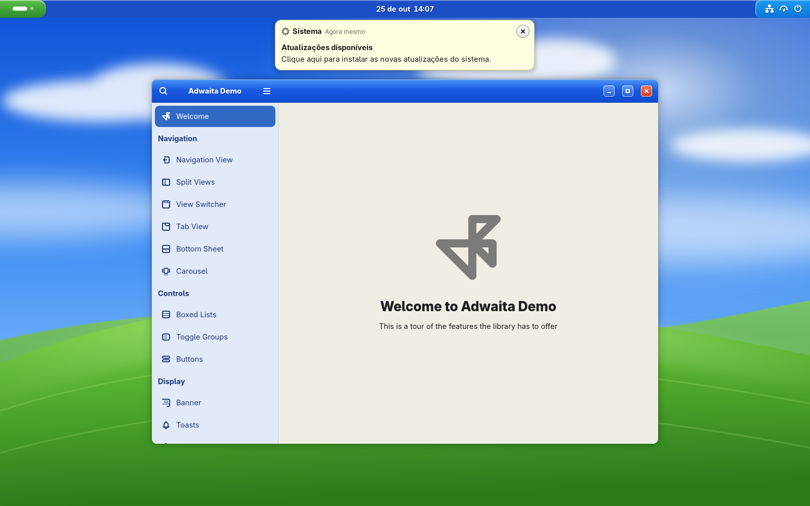
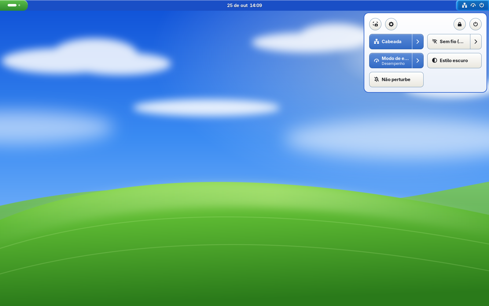
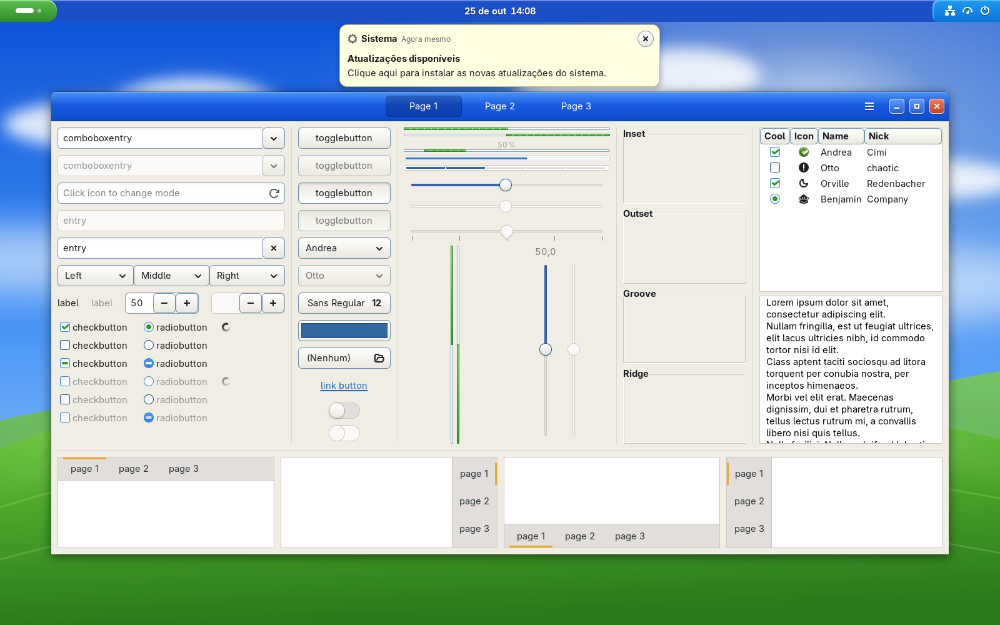
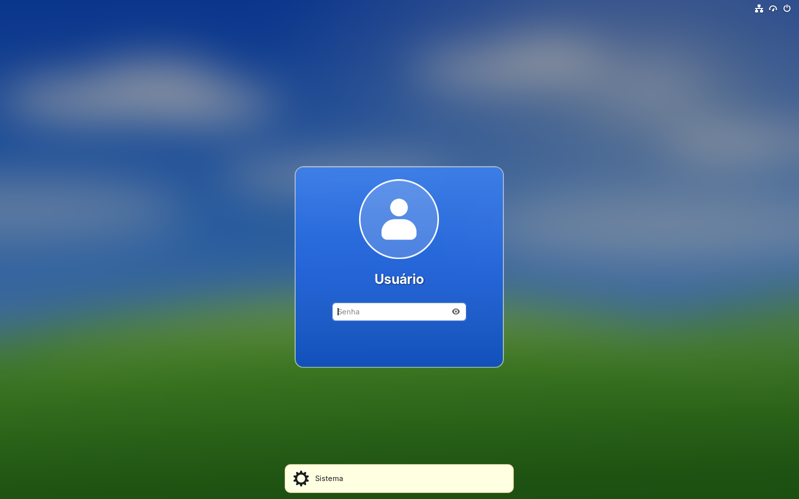
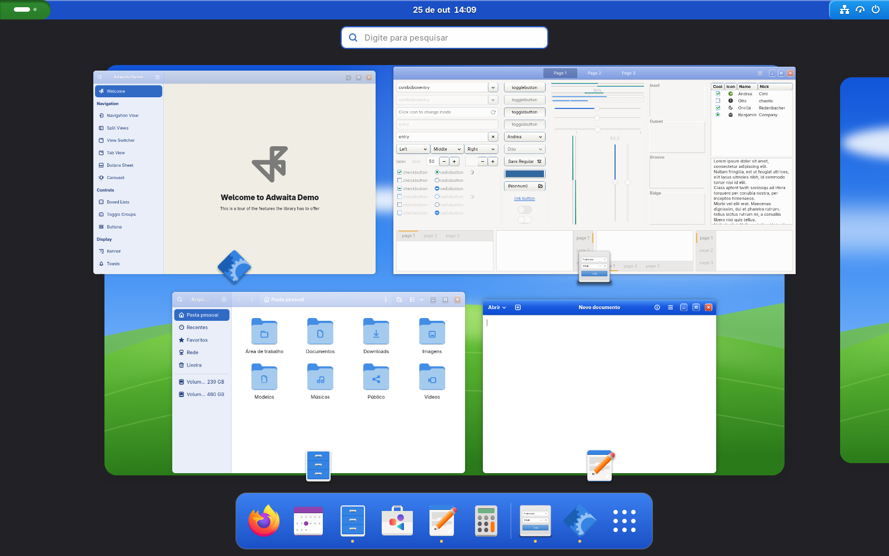
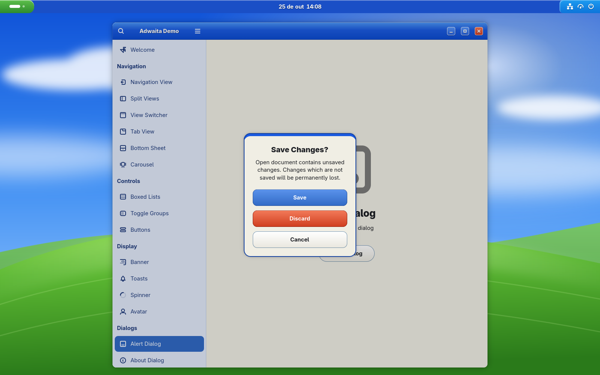
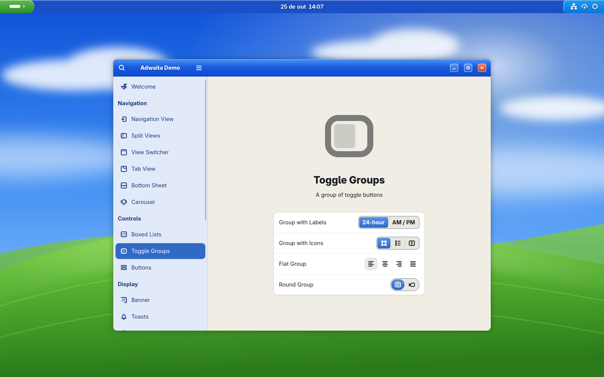

# WinXPRemix

The Windows XP **Luna** look reimagined for **GNOME 50+**: the blue taskbar, the green Start
button, gradient title bars and the yellow notification balloons, with rounded corners, clean
surfaces and a proper dark mode.

**Version 1.1.1** · [changelog](CHANGELOG.md)



| Quick settings | Calendar and notifications |
|---|---|
|  |  |

| Dark mode | GTK 3 |
|---|---|
|  |  |

| Lock screen | Overview |
|---|---|
|  |  |

| Alert dialog | Toggle groups |
|---|---|
|  |  |

## What changes

| Part | Look |
|---|---|
| **Top bar** | Luna taskbar in a blue gradient. "Activities" becomes a green pill in the style of the Start button, and the right side becomes a light-blue notification area |
| **Menus** | Blue border and items highlighted in `#316AC5` blue, like the XP menus |
| **Quick settings** | Light panel with XP-style buttons. Hover gets an orange outline and active buttons turn blue |
| **Notifications and tooltips** | Yellow `#FFFFE1` balloons |
| **Alt+Tab, OSD, dash** | Luna blue. The dash becomes a floating taskbar |
| **Windows (GTK4/libadwaita and GTK3)** | Blue gradient title bar with a bold title. Square minimize/maximize buttons and a red close button |
| **Controls** | Green check in a white box, green switches, green block progress bar, orange highlight on the active tab, toggle groups with the active item in blue, light-blue Explorer sidebar |
| **Dialogs** | Alerts with a blue strip on top and a frame, like XP windows (in the Shell and in libadwaita) |
| **Lock screen** | Clock and password field on a blue "Welcome" panel, avatar with a white frame and notifications as yellow balloons |
| **Wallpaper** | "Hill": original artwork inspired by the classic landscape, with day and night versions (switches automatically with dark mode) |

## Requirements

- GNOME Shell 50 or newer (tested on 50.6 / libadwaita 1.9 / GTK 4.22, Fedora 44)
- The **User Themes** extension, for the Shell theme (`sudo dnf install gnome-shell-extension-user-theme`)
- `sassc`, to build from source (optional, since `themes/` ships prebuilt)

## Installation

```bash
./install.sh
```

Everything goes into your user account, no `sudo`:

| Destination | Contents |
|---|---|
| `~/.themes/WinXPRemix` and `~/.themes/WinXPRemix-Dark` | Shell + GTK3 + GTK4 |
| `~/.config/gtk-4.0/gtk.css` | libadwaita override. If a file already existed, it is saved to `~/.local/share/winxpremix/` |
| `~/.local/share/backgrounds/winxpremix/` | Wallpapers, which also show up in Settings → Appearance |
| `~/.local/share/gnome-shell/extensions/winxpremix-lockscreen@winxpremix` | Helper extension that keeps the theme on the lock screen (User Themes is disabled when the screen locks) |
| `~/.local/bin/winxpremix-follow-scheme` + autostart | Switches the light/dark variants of the Shell and GTK3 themes along with GNOME's dark mode |
| Global Flatpak override (`--user`) | Read access to `~/.config/gtk-4.0`, so Flatpak apps pick up the theme too |

The script also enables the User Themes extension and the lock screen extension, selects the
theme and sets the window buttons to `minimize, maximize, close`. **Open apps need to be
reopened.** After the first install, log out and back in: the Shell only loads new extensions at
login, and until then the lock screen keeps the default look.

Options: `--no-apply`, `--no-gtk4`, `--no-wallpaper`, `--no-follow`, `--no-flatpak` (see `./install.sh --help`).

### Uninstall

```bash
./uninstall.sh
```

Removes the files and restores the theme, window buttons, wallpaper and `gtk.css` you had
before. The Flatpak access is only removed if `install.sh` granted it, and your other overrides
stay as they are.

## Layout

```
src/
  _palette.scss                 Luna colors (light/dark): single source for Shell, GTK3 and GTK4
  gnome-shell/_shell.scss       Shell theme (on top of the gnome-shell-light/dark.css base)
  gtk-3.0/_gtk3.scss            GTK3 (on top of the built-in Adwaita)
  gtk-4.0/palette.scss          generates the GTK4 --xp-* variables from the palette
  gtk-4.0/gtk.css               GTK4/libadwaita rules (no colors of their own; the build puts
                                the generated variables before them)
extras/winxpremix-follow-scheme follows light/dark mode
extras/winxpremix-lockscreen@winxpremix
                                extension that keeps the Shell theme on the lock screen
wallpapers/                     "Hill" day/night SVGs
wallpapers/LICENSE              CC BY 4.0 text (applies to the wallpapers only)
themes/                         build output (./build.sh), committed on purpose
VERSION                         current version (written to index.theme by the build)
CHANGELOG.md                    changelog
LICENSE                         GPL-3.0 text (applies to everything else)
```

### Development

After editing anything in `src/`, run `./build.sh` and then `./install.sh`.

- **GTK3/GTK4 apps:** just close and reopen them.
- **Shell:** on Wayland there is no `Alt+F2` → `r`. To reload the theme, disable and re-enable User Themes:

  ```bash
  gnome-extensions disable user-theme@gnome-shell-extensions.gcampax.github.com
  gnome-extensions enable user-theme@gnome-shell-extensions.gcampax.github.com
  ```

  Switching the theme away and back also works (`gsettings set org.gnome.shell.extensions.user-theme name ''`,
  then `'WinXPRemix'` or `'WinXPRemix-Dark'`). To see the lock screen, press `Super+L`.

When releasing a version, update `VERSION`, the version line at the top of this README and `CHANGELOG.md`.

## Known limitations

- **libadwaita has no official theming support.** The look of GTK4 apps comes from `~/.config/gtk-4.0/gtk.css`.
  It works well, but a major libadwaita update may need adjustments.
- **Every headerbar turns blue**, including the ones video players overlay on top of the content.
- **Flatpak apps** only read `gtk.css` if they have access to it. `install.sh` grants that already
  (`flatpak override --user --filesystem=xdg-config/gtk-4.0:ro`); use `--no-flatpak` to skip it.
- **Icons and cursors** are not part of the theme. The XP-style sets available on GNOME-Look go well with it.
- **Login (GDM)** keeps the default look, because it uses the system theme and needs root.
- **Lock screen:** User Themes is disabled when the screen locks, so the theme only shows there
  with the `winxpremix-lockscreen@winxpremix` extension, which `install.sh` installs. The blurred
  wallpaper sits on top of the screen background, so only the central panel gets the Luna blue,
  and the whole screen cannot be tinted.

## License

| What | License |
|---|---|
| Code: `src/`, `extras/`, `themes/` and the scripts | [GPL-3.0-or-later](LICENSE) |
| "Hill" wallpapers: `wallpapers/*.svg` | [CC BY 4.0](wallpapers/LICENSE), © 2026 pdrmottadev |

You can share and adapt the wallpapers, including commercially, as long as you give credit. For
example:

> "Hill" wallpaper by pdrmottadev, from [WinXPRemix](https://github.com/pdrmottadev/WinXPRemix),
> licensed under [CC BY 4.0](https://creativecommons.org/licenses/by/4.0/).

If you changed the wallpaper, say so in the credit (for example, "adapted from…").

The screenshots show third-party apps, icons and logos, which remain under their own licenses
and trademarks.

Windows and Windows XP are trademarks of Microsoft Corporation. WinXPRemix is a fan-made theme
and is not affiliated with or endorsed by Microsoft. It contains no Microsoft code or artwork:
the colors and layout are a reinterpretation, and the wallpapers are original.
