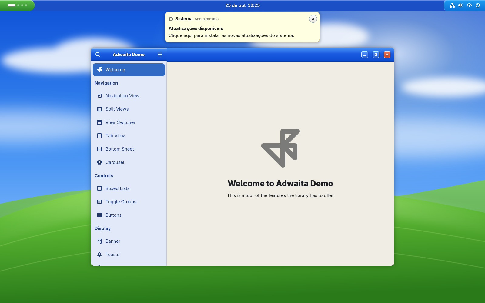
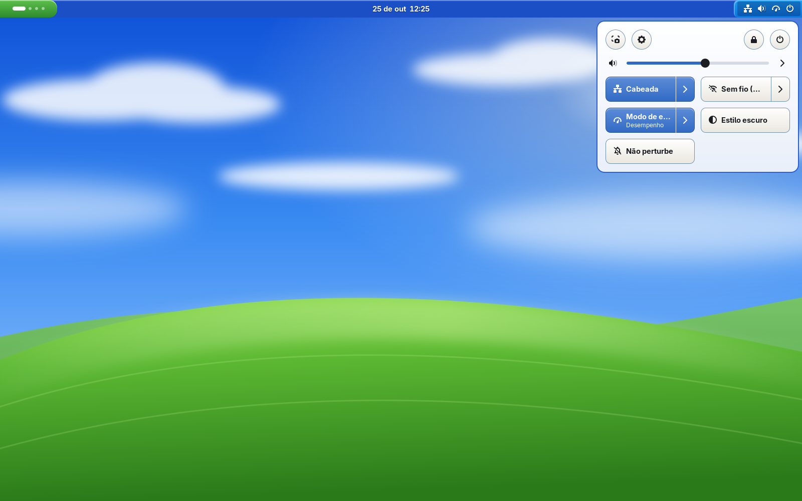
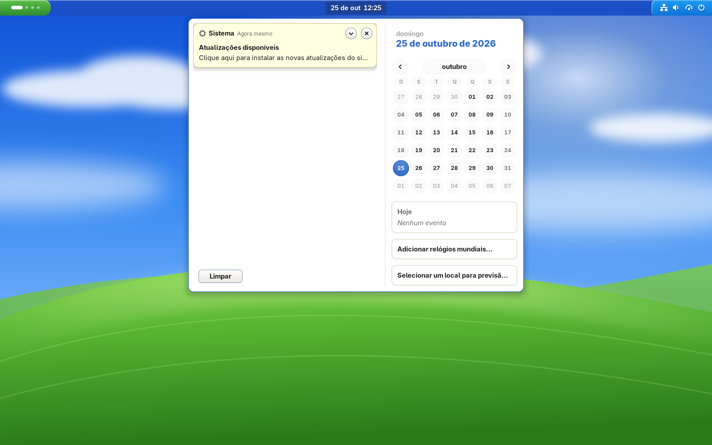
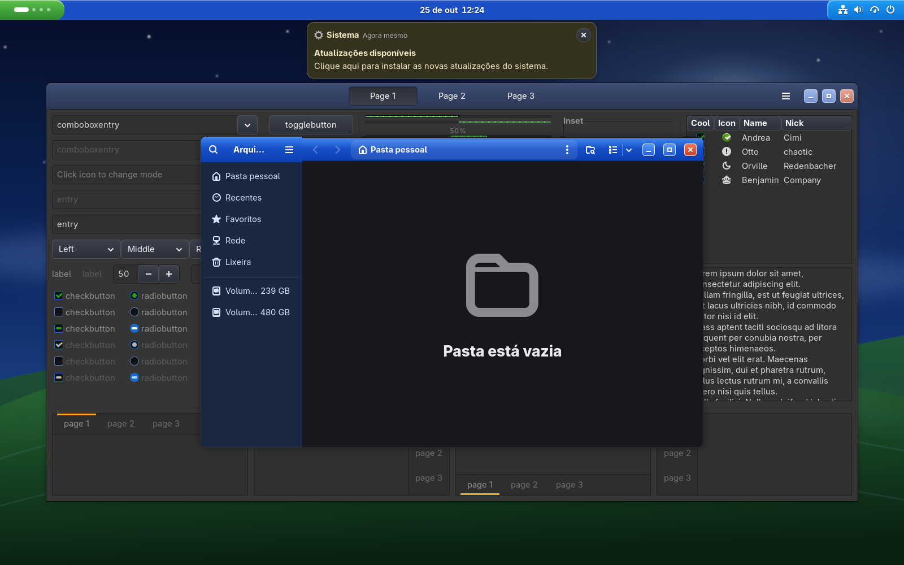

# WinXPRemix

O visual **Luna** do Windows XP reimaginado para o **GNOME 50+**: a barra de tarefas azul,
o botão Iniciar verde, barras de título em gradiente e os balões amarelos de notificação,
com cantos arredondados, superfícies limpas e um modo escuro de verdade.

**Versão 1.1.0** · [histórico de mudanças](CHANGELOG.md)



| Configurações rápidas | Calendário e notificações |
|---|---|
|  |  |

| Modo escuro | GTK 3 |
|---|---|
|  |  |

## O que muda

| Parte | Visual |
|---|---|
| **Barra superior** | Barra de tarefas Luna em gradiente azul. "Atividades" vira uma pílula verde no estilo do botão Iniciar, e o lado direito vira a área de notificação em azul-claro |
| **Menus** | Borda azul e item destacado em azul `#316AC5`, como nos menus do XP |
| **Configurações rápidas** | Painel claro com botões no estilo XP. O hover tem contorno laranja e os botões ativos ficam azuis |
| **Notificações e dicas** | Balões amarelos `#FFFFE1` |
| **Alt+Tab, OSD, dash** | Azul Luna. O dash vira uma barra de tarefas flutuante |
| **Janelas (GTK4/libadwaita e GTK3)** | Barra de título em gradiente azul com título em negrito. Botões minimizar/maximizar quadrados, e o fechar em vermelho |
| **Controles** | Check verde em caixa branca, chaves verdes, barra de progresso em blocos verdes, aba ativa com destaque laranja, grupos de alternância com o item ativo em azul, barra lateral azul-clara do Explorer |
| **Diálogos** | Alertas com faixa azul no topo e moldura, como as janelas do XP (no Shell e no libadwaita) |
| **Tela de bloqueio** | Relógio e campo de senha num painel azul "Bem-vindo", avatar com moldura branca e notificações em balões amarelos |
| **Papel de parede** | "Colina": arte original inspirada na paisagem clássica, com versão diurna e noturna (troca sozinha com o modo escuro) |

## Requisitos

- GNOME Shell 50 ou mais novo (testado no 50.6 / libadwaita 1.9 / GTK 4.22, Fedora 44)
- Extensão **User Themes**, para o tema do Shell (`sudo dnf install gnome-shell-extension-user-theme`)
- `sassc`, para compilar a partir do código-fonte (opcional, porque `themes/` já vem compilado)

## Instalação

```bash
./install.sh
```

Tudo fica na sua conta de usuário, sem `sudo`:

| Destino | Conteúdo |
|---|---|
| `~/.themes/WinXPRemix` e `~/.themes/WinXPRemix-Dark` | Shell + GTK3 + GTK4 |
| `~/.config/gtk-4.0/gtk.css` | Override do libadwaita. Se já existia um arquivo, ele é guardado em `~/.local/share/winxpremix/` |
| `~/.local/share/backgrounds/winxpremix/` | Papéis de parede, que também aparecem em Configurações → Aparência |
| `~/.local/bin/winxpremix-follow-scheme` + autostart | Troca as variantes clara/escura do Shell e do GTK3 junto com o modo escuro do GNOME |
| Override global do Flatpak (`--user`) | Acesso de leitura a `~/.config/gtk-4.0`, para apps Flatpak também pegarem o tema |

O script também ativa a extensão User Themes, seleciona o tema e ajusta os botões da janela para
`minimizar, maximizar, fechar`. **Apps abertos precisam ser reabertos.**

Opções: `--no-apply`, `--no-gtk4`, `--no-wallpaper`, `--no-follow`, `--no-flatpak` (veja `./install.sh --help`).

### Desinstalar

```bash
./uninstall.sh
```

Remove os arquivos e restaura o tema, os botões, o papel de parede e o `gtk.css` que você
tinha antes. A liberação do Flatpak só é desfeita se foi o `install.sh` que a criou, e os seus
outros overrides continuam como estão.

## Estrutura

```
src/
  _palette.scss                 cores Luna (claro/escuro): fonte única para Shell, GTK3 e GTK4
  gnome-shell/_shell.scss       tema do Shell (sobre a base gnome-shell-light/dark.css)
  gtk-3.0/_gtk3.scss            GTK3 (sobre o Adwaita embutido)
  gtk-4.0/palette.scss          gera as variáveis --xp-* do GTK4 a partir da paleta
  gtk-4.0/gtk.css               regras do GTK4/libadwaita (sem cores próprias; o build junta
                                as variáveis geradas antes delas)
extras/winxpremix-follow-scheme acompanha o modo claro/escuro
wallpapers/                     SVGs "Colina" dia/noite
themes/                         saída compilada (./build.sh), versionada de propósito
VERSION                         versão atual (vai para o index.theme no build)
CHANGELOG.md                    histórico de mudanças
```

### Desenvolvimento

Depois de editar algo em `src/`, rode `./build.sh` e depois `./install.sh`.

- **Apps GTK3/GTK4:** basta fechar e abrir de novo.
- **Shell:** no Wayland o `Alt+F2` → `r` não existe. Para recarregar o tema, desative e reative a User Themes:

  ```bash
  gnome-extensions disable user-theme@gnome-shell-extensions.gcampax.github.com
  gnome-extensions enable user-theme@gnome-shell-extensions.gcampax.github.com
  ```

  Também funciona trocar o tema e voltar (`gsettings set org.gnome.shell.extensions.user-theme name ''`
  e depois `'WinXPRemix'` ou `'WinXPRemix-Dark'`). Para ver a tela de bloqueio, use `Super+L`.

Ao lançar uma versão, atualize o `VERSION`, a linha de versão no topo deste README e o `CHANGELOG.md`.

## Limitações conhecidas

- **libadwaita não tem suporte oficial a temas.** O visual dos apps GTK4 vem do `~/.config/gtk-4.0/gtk.css`.
  Funciona bem, mas uma atualização grande do libadwaita pode exigir ajustes.
- **Todas as headerbars ficam azuis**, inclusive as de players de vídeo que ficam sobre o conteúdo.
- **Apps Flatpak** só leem o `gtk.css` se tiverem acesso a ele. O `install.sh` já libera isso
  (`flatpak override --user --filesystem=xdg-config/gtk-4.0:ro`); use `--no-flatpak` para não liberar.
- **Ícones e cursores** não fazem parte do tema. Combinam bem com ele os sets no estilo XP disponíveis no GNOME-Look.
- **Login (GDM)** continua com o visual padrão, porque usa o tema do sistema e exige root.
- **Tela de bloqueio:** o papel de parede desfocado fica por cima do fundo da tela, então só o
  painel central recebe o azul Luna, e a tela inteira não pode ser tingida.
